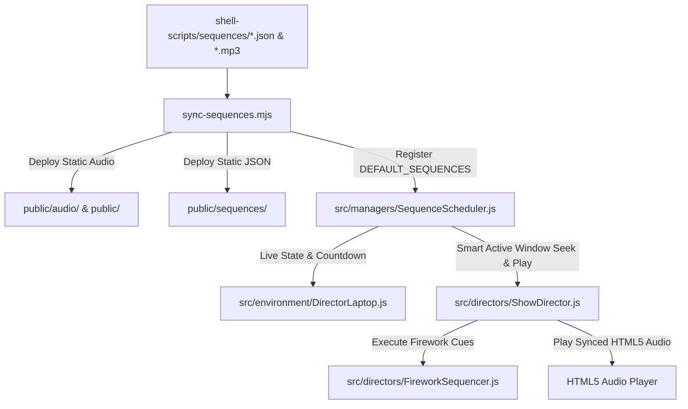

# Quy trinh nap Sequence Phao hoa (Sequence Ingestion Workflow)

Tai lieu nay huong dan chi tiet cach nap, dang ky va dong bo cac kịch ban phao hoa (sequence scripts) kem am thanh tu thu muc `shell-scripts/sequences/` vao he thong trinh dien tu dong (`SequenceScheduler`, `DirectorLaptop` va `ShowDirector`).

---

## 1. Ban do Kien truc Sequence (Architecture Map)



---

## 2. Cach thuc hien nhanh bang Script tu dong

Chi can chay lenh sau trong terminal:

```powershell
node .agents/skills/ds-create-sequence/scripts/sync-sequences.mjs
```

Script se tu dong:
1. Quet toan bo file `.json` trong `shell-scripts/sequences/`.
2. Trich xuat thong tin cue, phan doan thoi gian (`minTime`, `maxTime`), va file am thanh neu co.
3. Kiem tra xem file am thanh (.mp3) da co trong `public/` va `public/audio/` chua. Neu chua co, tu dong copy sang.
4. Kiem tra xem file json da co trong `public/sequences/` chua. Neu chua co, tu dong copy sang.
5. Kiem tra xem sequence ID da duoc khai bao trong `DEFAULT_SEQUENCES` cua `src/managers/SequenceScheduler.js` chua. Neu chua co, tu dong chen import va tao ban ghi moi vao danh sach.
6. Bao cao ket qua ro rang ve so luong file da copy va cac sequence moi duoc dang ky.

---

## 3. Quy trinh thuc hien thu cong tung buoc (Manual Workflow)

Neu can tuy bien kịch ban thu cong, thuc hien theo cac buoc sau:

### Buoc 1: Kiem tra Kịch ban va File Am thanh
1. Mo tep `shell-scripts/sequences/<ten-kich-ban>.json`.
2. Kiem tra xem co node audio khong:
   ```json
   {
     "time": 0,
     "type": "audio",
     "name": "my_song.mp3",
     "url": "my_song.mp3"
   }
   ```
3. Kiem tra thoi gian bat dau cua chùm phao hoa dau tien (`firstTime`) va cuoi cung (`lastTime`).

### Buoc 2: Trien khai File tinh vao `public/`
1. Neu kịch ban co dung nhac, sao chep file `.mp3` vao ca hai thu muc:
   - `public/<my_song.mp3>`
   - `public/audio/<my_song.mp3>`
   *(Neu da co thi giu nguyen, khong copy de).*
2. Sao chep file json kịch ban vao `public/sequences/<ten-kich-ban>.json`.

### Buoc 3: Dang ky vao `SequenceScheduler.js`
1. Mo file `src/managers/SequenceScheduler.js`.
2. Them import kịch ban o dau file:
   ```javascript
   import mySequence from '../../shell-scripts/sequences/my_sequence.json';
   ```
3. Them ban ghi vao mang `DEFAULT_SEQUENCES`:
   ```javascript
   {
     id: 'my_sequence_id',
     title: 'Ten Kich Ban Hien Thi',
     category: 'Vocal EDM Hanabi Sequence',
     audioTrack: 'my_song.mp3', // hoac null neu khong co nhac
     duration: 30.0, // thoi luong phan doan
     interval: 60.0, // thoi gian dem nguoc tren laptop truoc khi ban
     cues: mySequence
   }
   ```

### Buoc 4: Kiem tra Smart Active Window Seeking
He thong trong `SequenceScheduler.js` da tich hop co che tu dong phat hien:
- Neu `firstTime > 5.0` (vi du: am nhac bat dau tu giay 0 nhung phao hoa no tu giay 86.3s):
  `this.activeStartTime = Math.max(0, firstTime - 0.6)`
  `showDirector.seek(this.activeStartTime)`
- Khi dong ho laptop ve `00:00.0`, nhac se duoc tua thang den giay thu 85.7s va phao hoa bung no dung nhip drop dau tien, triet tieu hoan toan khoang chet 86 giay.

### Buoc 5: Chay Test va Build kiem tra
Chay bo kiem thu va lenh build:
```powershell
npx vitest run tests/managers/SequenceScheduler.test.js
npm run build
```
Dam bao toan bo test suite dat 100% va Vite build khong co bat ky loi nao.

