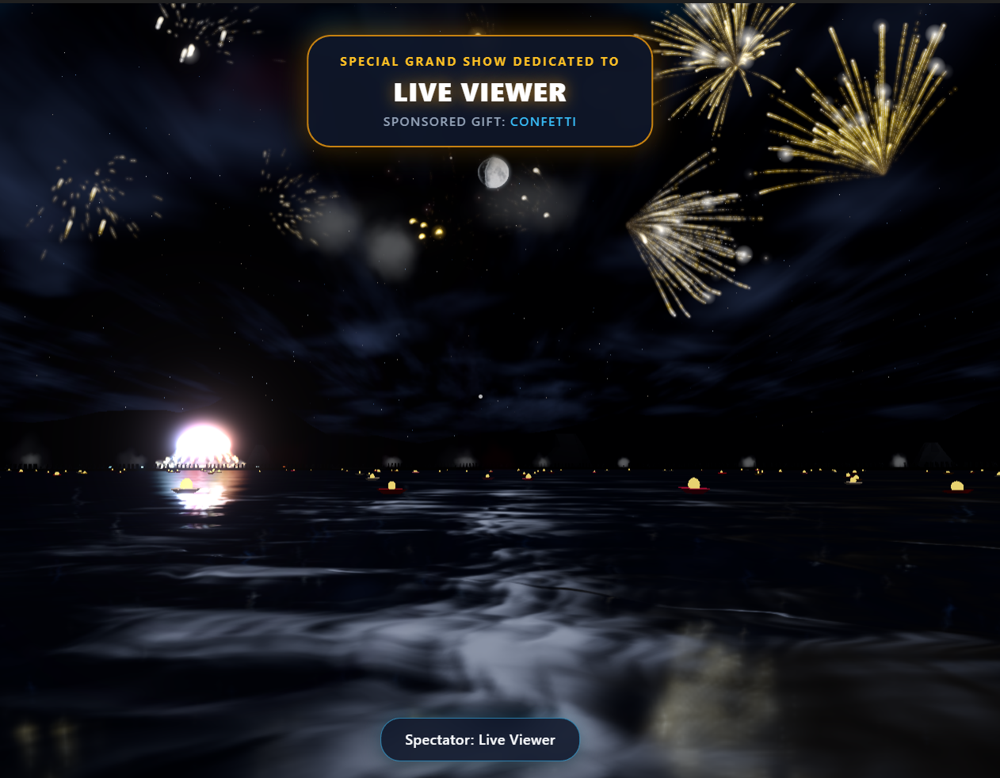
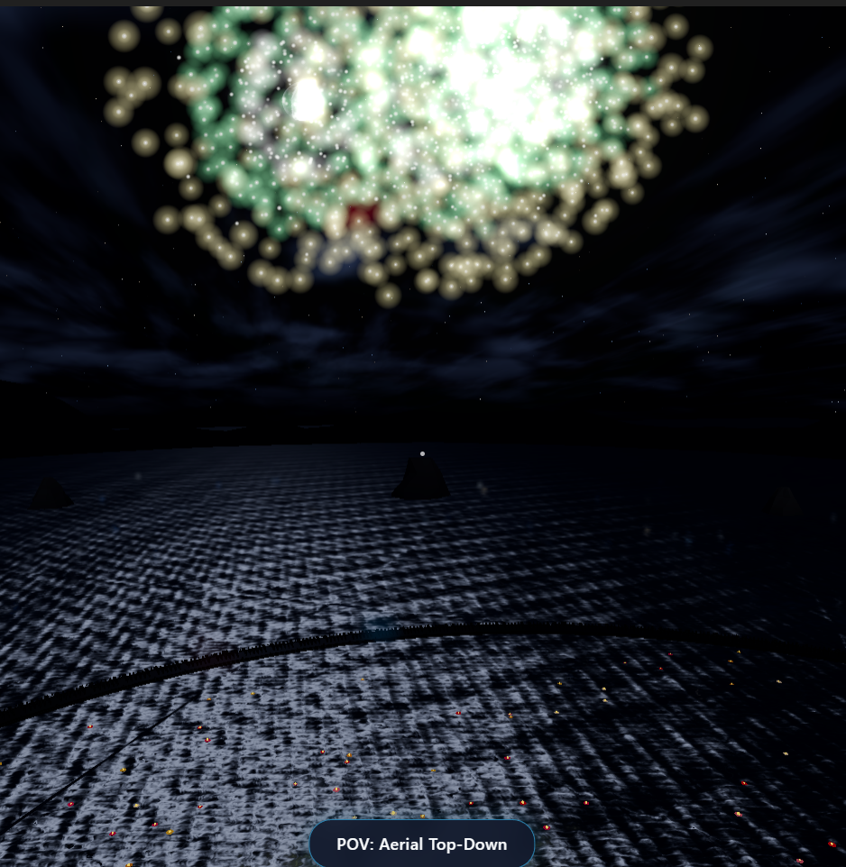
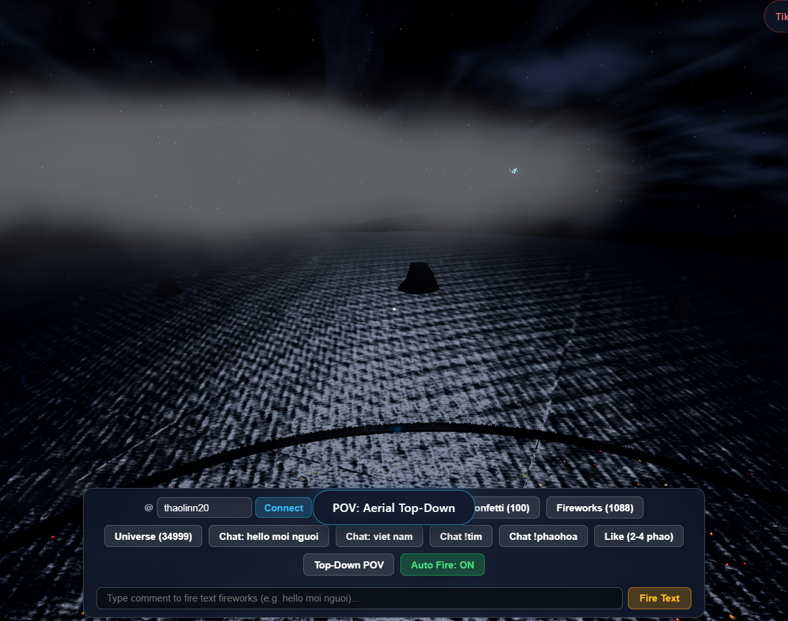

# FDShowLive (3D Drone & Firework Live Simulation)

**Languages:** [English](README_en.md) | [Tiếng Việt](README_vi.md) | [日本語](README_ja.md) | [中文](README_zh.md)

FDShowLive is a real-time 3D pyrotechnic and drone simulation application designed specifically for broadcasting and interactive engagement on TikTok Live. Built on **Three.js**, **Vite**, and **Electron**, the application connects directly to live broadcast rooms through a local WebSocket bridge daemon and TikFinity Webhooks.

---

## 1. Key Features

### Real-Time TikTok Live Interaction
- **Likes**: Every audience like triggers mini burst clusters and low-altitude comets cascading over the water surface to acknowledge viewers.
- **Chat & Word Fireworks**:
  - System trigger commands such as `!tim` and `!phaohoa` launch corresponding signature fireworks.
  - Procedural Word Fireworks: Automatically parses words from viewer comments and launches sequential letter fireworks that spell words across the sky using a point atlas coordinate system.
- **Gifts & Priority Sequence Queue**:
  - Full support for TikTok gift tiers, ranging from standard gifts (Rose, Finger Heart, Confetti) to high-tier gifts (Fireworks, TikTok Universe).
  - Premium gifts trigger scheduled musical firework sequences and synchronized drone formations with top priority in the execution queue.
  - Automatically shifts camera focus to the 3D spectator character representing the gifting sponsor for 25 seconds.

### 3D Viewing Deck & Spectator Crowd
- Dynamic beachside grandstand populated with dozens of seated and standing 3D spectators viewing the show.
- Athletic jersey plate banners displayed on spectators' backs featuring FWA branding, auto-scaled bold viewer names, and honorary achievement ribbons.
- **Spectator Tour**: During musical sequence playback, the camera smoothly tours across spectator positions (5 seconds per viewer), providing the authentic experience of sitting in the audience.
- Unobstructed Sightlines: The currently focused spectator character is automatically hidden, while adjacent spectators decrease opacity (to 0.78) to ensure a 100% open field of view toward the fireworks stage.

### Intelligent Cinematic Camera System
- **Beachgoer POV**: Default vantage seated on the sand dunes, looking across the tranquil lake reflecting fireworks lighting up the night sky.

- **Aerial Bird Flyover POV**:

  - Soaring high-altitude trajectory (Y = 235m to 255m, Z = 380m to 405m) with look target anchored high at Y = 145m, capturing all shells bursting from low altitude (75m) up to the maximum ceiling (400m).
  - Balanced natural probability: 30% random trigger on single/ambient launches; throttled to at most 5% at the sequence level to preserve spectator immersion during choreographed shows.
  - When the aerial flyover finishes, the camera smoothly lands back directly behind the active spectator without aborting the ongoing tour.

### Streamer Test Toolbar & Clean Feed Mode
- **Quick Test Toolbar (Hotkey F9)**: Bottom-docked test panel to connect TikTok usernames, simulate chats, likes, and gifts, and trigger camera perspectives before going live.
- **Clean Feed Mode (Hotkey F10)**: Instantly hides all HUD overlays, diagnostic stats, crosshairs, and menus with a single keystroke, providing a pristine 3D scene ready for stream capture.


### Professional Pyrotechnic Physics Engine
- Seamlessly powered by the centralized `@shell-drone/firework-engine` library.
- Closed-form analytical damped velocity kinematics simulated on GPU vertex shaders, zero CPU allocation loops, authentic lingering pyrotechnic embers, launch tube flash, water planar reflections, and atmospheric flash lighting.

---

## 2. System Requirements

- **Operating System**: Windows 10 / 11 (64-bit).
- **Node.js**: Version 18 or higher (LTS release recommended).
- **Git**: For cloning and updating the repository.
- **Livestream Software**: TikTok LIVE Studio or OBS Studio.
- **Optional Utility**: TikFinity (if utilizing Webhook integration).

---

## 3. Installation & Running the Application

### Step 1: Clone the Repository
Open Terminal or PowerShell and run:
```bash
git clone https://github.com/ThaoLinn20/Shell-Drone-Live.git
cd shell-drone-live
```

### Step 2: Install Dependencies
Run the command below to install all required packages:
```bash
npm install
```

### Step 3: Launch the Application

Select one of the launch modes based on your workflow:

#### Mode 1: All-in-One Live Stream (Recommended for Streamers)
This command launches both the TikTok WebSocket Bridge Daemon and the Electron Desktop Application concurrently:
```bash
npm run live
```
*(Or use the equivalent command: `npm run live:desktop`)*

#### Mode 2: Run in Web Browser
To run on a standard browser (Chrome/Edge) connected to the bridge:
```bash
npm run live:web
```
Access the application at: `http://localhost:5173/`

#### Mode 3: Run Components Independently
For debugging or running services separately:
- Launch Bridge Server connected to a specific TikTok account:
  ```bash
  node bridge/server.js [tiktok_username]
  ```
  *(Example: `node bridge/server.js thaolinn20`)*
- Launch Electron Desktop Application:
  ```bash
  npm run electron:dev
  ```

---

## 4. Connecting to TikTok Livestream

You can connect live events into the 3D application using either of the two methods below:

### Method 1: Direct Connection via TikTok Live Connector (Easiest)
1. Start your livestream on your TikTok account via your phone or TikTok LIVE Studio.
2. Launch the application using `npm run live`.
3. Press **F9** in the application window to open the Test Toolbar.
4. Enter your TikTok username in the **TikTok @username** field and click **Connect**.
5. The WebSocket bridge will automatically hook into the live room and immediately dispatch incoming likes, comments, and gifts into the 3D world.

### Method 2: Connection via TikFinity Webhook (High Reliability)
TikFinity serves as a dedicated live event relay for TikTok Live:
1. Download and install **TikFinity** from its official website.
2. Log in with your TikTok account in TikFinity and connect to your active livestream.
3. In TikFinity, navigate to **Actions & Events** -> **Webhooks** (or configure a Webhook Trigger).
4. Set the Webhook URL to:
   ```text
   http://localhost:21213/api/webhook
   ```
5. Set HTTP Method to `POST` and Content-Type to `JSON`.
6. Enable triggers for: **Gift**, **Chat / Comment**, **Like / Share**.
7. The application will receive payloads from TikFinity, normalize event schemas, and fire corresponding fireworks in 3D.

---

## 5. Capturing Video into TikTok LIVE Studio / OBS Studio

1. Open **TikTok LIVE Studio** (or OBS Studio).
2. Under the Scenes & Sources panel, click **Add Source**.
3. Choose **Window Capture** or **Game Capture**.
4. Select the window titled **FDLiveStream** (or browser window `localhost:5173`).
5. Adjust frame aspect ratio (typically 16:9 landscape or 9:16 portrait depending on your layout).
6. Focus the 3D firework window and press **F10**:
   - The application toggles into **Clean Feed** mode.
   - All HUD labels, diagnostic panels, cursor, and menus disappear, leaving only the pristine 3D performance ready for broadcast.

---

## 6. Shortcuts and Controls Reference

### Streamer Production Shortcuts
| Shortcut | Function |
| :--- | :--- |
| **F9** | Toggle Streamer Quick Test Toolbar |
| **F10** | Toggle Clean Feed Mode (hides all HUD and interface overlays) |
| **ESC** | Lock or release mouse pointer lock |
| **SHIFT + Y** | Toggle System Diagnostics HUD |

### 3D Camera Navigation
| Action | Function |
| :--- | :--- |
| **Left Click** | Lock mouse cursor and rotate perspective |
| **W, A, S, D** | Move camera position horizontally |
| **SHIFT + W / S** | Elevate or lower camera height |
| **SHIFT + R** | Reset camera position to grandstand center |
| **1** | Switch to Free Camera Mode |
| **2** | Switch to River Boat Vantage Mode |
| **3** | Switch to Overhead Aerial View Mode |

### Timeline & Show Control
| Shortcut | Function |
| :--- | :--- |
| **CTRL + T** | Toggle Timeline Script Editor Panel |
| **SPACE** | Play or pause current sequence |
| **CTRL + S** | Save edits directly to sequence JSON file |
| **CTRL + Z / Y** | Undo / Redo previous action |

---

## 7. Firework Engine Synchronization & Updates

All pyrotechnic mathematics, geometries, kinematics, and effect presets are managed centrally in **[@shell-drone/firework-engine](https://github.com/ThaoLinn20/firework-engine)**.

Whenever new firework features or performance enhancements are released, update your local project by running:
```bash
npm update @shell-drone/firework-engine
```

Verify that all unit tests pass:
```bash
npm test
```

---

## 8. Windows Desktop Application Packaging

To compile and package the entire project into an independent Windows Desktop installer (`.exe` or standalone portable `.zip`):

Execute the build command:
```bash
npm run electron:build
```
Compiled installers and portable packages are saved in the `dist-electron/` folder.

---

## 9. Release Notes

Detailed release history, bug fixes, and feature logs are documented in [RELEASE_NOTES.md](../../RELEASE_NOTES.md).
