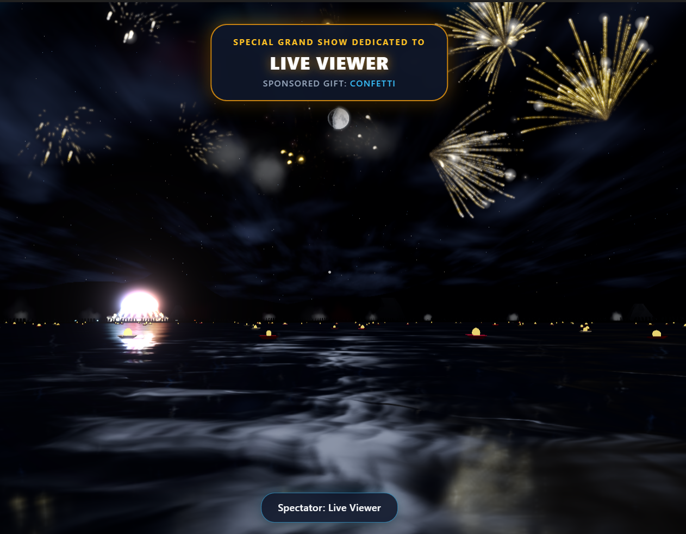
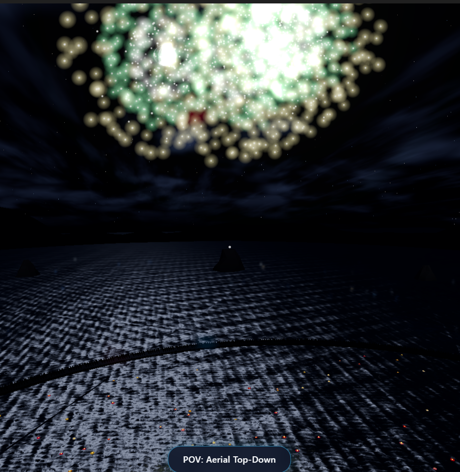
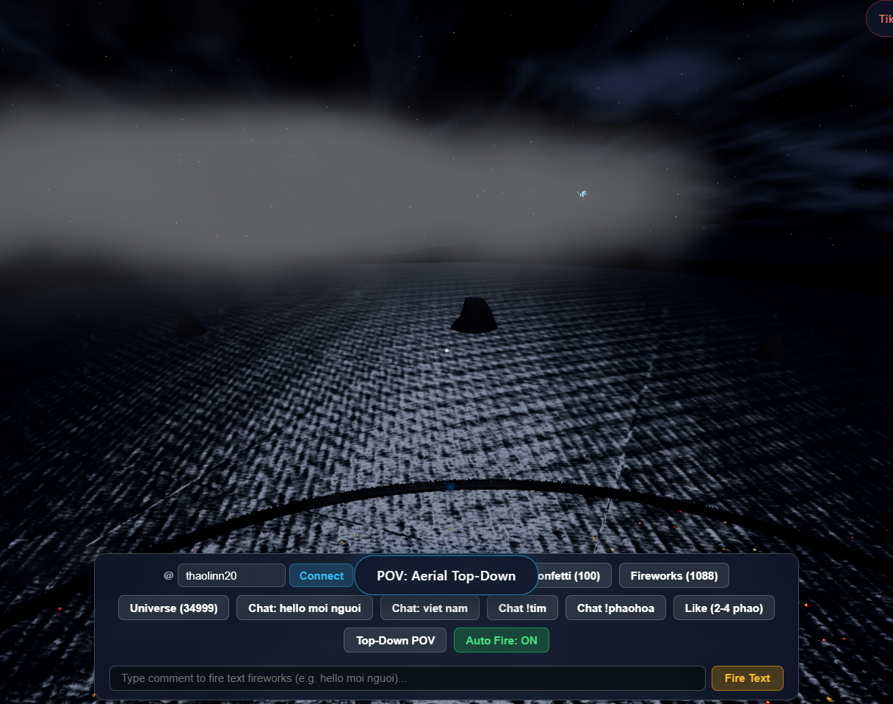

# FDShowLive (3Dドローン＆花火ライブシミュレーション)

**言語:** [English](README_en.md) | [Tiếng Việt](README_vi.md) | [日本語](README_ja.md) | [中文](README_zh.md)

FDShowLive は、TikTok Live でのライブ配信および双方向インタラクション向けに特別設計された、リアルタイム3D花火＆ドローン演出シミュレーションアプリケーションです。**Three.js**、**Vite**、および **Electron** を基盤とし、ローカルの WebSocket ブリッジデーモンおよび TikFinity Webhook を介して配信ルームと直接連携します。

---

## 1. 主な機能

### リアルタイム TikTok Live インタラクション
- **いいね (Likes)**: 視聴者からのいいねを受け取るたびに、水面近くでミニバーストクラスタや低空コメットが連続して打ち上がり、感謝の演出を行います。
- **チャット＆文字花火 (Chat & Word Fireworks)**:
  - `!tim` や `!phaohoa` などのシステムコマンドにより、対応する演出花火が即座に打ち上がります。
  - プロシージャル文字花火機能: 視聴者のコメントから単語を自動抽出し、ポイントアトラス座標系に基づいて夜空にアルファベット順の文字花火を描き出します。
- **ギフト＆優先シーケンスキュー (Gifts & Priority Sequence Queue)**:
  - 基本ギフト（バラ、指ハート、紙吹雪）から高額ギフト（花火、TikTok Universe）まで、幅広いギフトランクに対応しています。
  - 特別なギフトが届くと、最優先キューによって音楽付き花火シーケンスおよびドローン編隊飛行ショーが発動します。
  - ギフトを贈った視聴者のアバター（3D観客キャラクター）へ、カメラが25秒間自動的にフォーカスします。

### 3D観客席＆オーディエンスシステム (Spectator Crowd)
- 海辺の観客スタンドに多数の3D観客キャラクターが着席・起立し、リアルな花火鑑賞の臨場感を再現します。
- 観客の背中にはFWAブランド、太字で読みやすく拡大されたユーザー名、栄誉リボンが付いたユニフォーム風ネームプレート（Jersey Plate Banner）が表示されます。
- **観客ツアー (Spectator Tour)**: シーケンス再生中、カメラが各観客の視点をスムーズに巡回（1人あたり5秒間）し、客席から花火を見上げる体験を提供します。
- 視界の最適化: 現在フォーカスされている観客アバターは自動的に非表示になり、周囲の観客は半透明（不透明度0.78）になるため、ステージ方向の視界が100%クリアに保たれます。

### インテリジェント・シネマティックカメラシステム
- **砂浜観客視点 (Beachgoer POV)**: 砂浜に座り、静かな湖面に映る光と夜空に広がる花火を一望するデフォルト視点です。

- **上空鳥瞰視点 (Aerial Bird Flyover POV)**:

  - 上空（Y = 235m～255m、Z = 380m～405m）を滑空し、注視点を高度145mに設定することで、低空75mから最大到達点400mまでの花火を完全に画角内に収めます。
  - 自然な確率制御: 通常の単発・環境打ち上げ時は30%のランダム確率で発動し、シーケンス（ショー）実行中は観客目線を最優先するため、シーケンス全体で最大5%に制限されます。
  - 鳥瞰視点が終了すると、カメラは現在鑑賞中の観客の背後へ滑らかに着地し、観客ツアーを中断することなく継続します。

### 配信者用テストツールバー＆クリーンフィードモード
- **クイックテストツールバー (キー: F9)**: 画面下部にテストパネルを表示し、TikTokアカウントの接続、チャット・いいね・ギフトのシミュレーション、視点切り替えを本番前に素早く検証できます。
- **クリーンフィードモード (キー: F10)**: すべてのHUD表示、診断パネル、照準点、メニューをワンキーで非表示にし、配信ソフトへ取り込むための美しい3D映像のみを表示します。


### プロ仕様の花火物理シミュレーションエンジン
- 独立した中央ライブラリ `@shell-drone/firework-engine` と直接連携。
- GPU頂点シェーダー上で空気抵抗を考慮した解析的速度減衰モデル（analytical damped velocity）を実行し、CPU負荷ゼロで数万粒の光粒子、打ち上げ筒の煙、水面反射、閃光ライティングを忠実に再現します。

---

## 2. システム要件

- **OS**: Windows 10 / 11 (64-bit)。
- **Node.js**: バージョン 18 以上（最新の LTS 版を推奨）。
- **Git**: ソースコードのクローンおよび更新用。
- **配信ソフトウェア**: TikTok LIVE Studio または OBS Studio。
- **サポートツール (任意)**: TikFinity（Webhook 連携を行う場合）。

---

## 3. インストールと起動手順

### ステップ 1: リポジトリのクローン
ターミナルまたは PowerShell を開き、次のコマンドを実行します。
```bash
git clone https://github.com/ThaoLinn20/Shell-Drone-Live.git
cd shell-drone-live
```

### ステップ 2: 依存関係のインストール
必要なパッケージをすべてインストールします。
```bash
npm install
```

### ステップ 3: アプリケーションの起動

用途に合わせて以下の起動方法を選択してください。

#### 方法 1: オールインワン配信起動 (配信者に推奨)
TikTok WebSocket ブリッジデーモンと Electron デスクトップアプリを同時に起動します。
```bash
npm run live
```
*(同等のコマンド: `npm run live:desktop`)*

#### 方法 2: Webブラウザで実行
ブリッジと連携した状態で通常のブラウザ（Chrome / Edge）で実行する場合：
```bash
npm run live:web
```
ブラウザから `http://localhost:5173/` にアクセスします。

#### 方法 3: 各コンポーネントを個別に起動
デバッグやサーバー単体での動作確認を行う場合：
- 特定の TikTok アカウントに接続してブリッジサーバーを起動:
  ```bash
  node bridge/server.js [tiktok_username]
  ```
  *(例: `node bridge/server.js thaolinn20`)*
- Electron デスクトップアプリを起動:
  ```bash
  npm run electron:dev
  ```

---

## 4. TikTok ライブ配信への接続方法

以下のいずれかの方法でライブ配信のイベントを3D空間へ連携できます。

### 方法 1: TikTok Live Connector による直接接続 (最も簡単)
1. スマートフォンまたは TikTok LIVE Studio から TikTok 配信を開始します。
2. コマンド `npm run live` でアプリを起動します。
3. アプリ画面で **F9** キーを押し、テストツールバーを開きます。
4. **TikTok @username** 欄にお使いの TikTok ユーザー名を入力し、**Connect** をクリックします。
5. WebSocket ブリッジが配信ルームへ自動接続し、いいね・コメント・ギフトの受信を開始します。

### 方法 2: TikFinity Webhook 連携 (高安定性)
TikFinity を中継サーバーとして利用することで、高い安定性を確保できます。
1. **TikFinity** 公式サイトからアプリをダウンロードしてインストールします。
2. TikFinity で TikTok アカウントにログインし、配信中ルームに接続します。
3. TikFinity 画面で **Actions & Events** -> **Webhooks**（または Webhook トリガー設定）を開きます。
4. 送信先 Webhook URL を次のように設定します。
   ```text
   http://localhost:21213/api/webhook
   ```
5. HTTP メソッドを `POST`、データ形式を `JSON` に設定します。
6. トリガー対象として **Gift**、**Chat / Comment**、**Like / Share** を有効にします。
7. TikFinity から送信されたデータがアプリ側で自動正規化され、3D空間で花火が打ち上がります。

---

## 5. TikTok LIVE Studio / OBS Studio への画面取り込み設定

1. **TikTok LIVE Studio**（または OBS Studio）を開きます。
2. シーン＆ソース管理エリアで **ソースを追加** をクリックします。
3. **ウィンドウキャプチャ** または **ゲームキャプチャ** を選択します。
4. 対象ウィンドウとして **FDLiveStream**（またはブラウザの `localhost:5173`）を選択します。
5. 画面のアスペクト比を配信レイアウトに合わせて調整します（横画面 16:9 または縦画面 9:16）。
6. 花火アプリのウィンドウをクリックしてアクティブにし、**F10** キーを押します。
   - 画面が **Clean Feed**（クリーンフィード）モードに切り替わります。
   - すべてのHUD、デバッグ情報、マウスポインタ、メニューが非表示になり、美しい3Dステージ映像のみが配信画面に映し出されます。

---

## 6. ショートカットキーと操作一覧

### 配信者用コントロール
| ショートカット | 機能 |
| :--- | :--- |
| **F9** | テストツールバーの表示 / 非表示切り替え |
| **F10** | クリーンフィードモードの切り替え（全HUD・メニューの非表示） |
| **ESC** | マウスポインタのロック / ロック解除 |
| **SHIFT + Y** | システム診断HUDの表示 / 非表示切り替え |

### 3Dカメラ操作
| 操作 | 機能 |
| :--- | :--- |
| **左クリック** | マウスをロックして視点を自由に回転 |
| **W, A, S, D** | カメラの前後左右移動 |
| **SHIFT + W / S** | カメラ高度の上昇 / 下降 |
| **SHIFT + R** | カメラ位置を観客席中央へリセット |
| **1** | フリーカメラ視点へ切り替え |
| **2** | 川舟視点（Boat View）へ切り替え |
| **3** | 上空パノラマ視点（Birds Eye View）へ切り替え |

### タイムライン＆シーケンス操作
| ショートカット | 機能 |
| :--- | :--- |
| **CTRL + T** | タイムライン編集パネルの表示 / 非表示 |
| **SPACE** | 現在のシーケンスの再生 / 一時停止 |
| **CTRL + S** | 編集内容をシーケンス JSON ファイルへ直接保存 |
| **CTRL + Z / Y** | 操作の元に戻す (Undo) / やり直し (Redo) |

---

## 7. 花火エンジンの同期とアップデート

花火の物理挙動、幾何学形状、動力学、およびプリセットは中央リポジトリ **[@shell-drone/firework-engine](https://github.com/ThaoLinn20/firework-engine)** で一元管理されています。

花火エンジンの新機能やパフォーマンス改善を取り込むには、プロジェクトルートで以下を実行します。
```bash
npm update @shell-drone/firework-engine
```

テストを実行して動作確認を行います。
```bash
npm test
```

---

## 8. Windows デスクトップアプリのビルドとパッケージ化

プロジェクト全体を Windows 用の独立したインストーラー（`.exe` またはポータブル `.zip`）としてパッケージ化する場合：

次のビルドコマンドを実行します。
```bash
npm run electron:build
```
パッケージ化された成果物は `dist-electron/` フォルダに出力されます。

---

## 9. リリースノート

詳細な更新履歴、バグ修正、および新機能情報は [RELEASE_NOTES.md](../../RELEASE_NOTES.md) に記録されています。
