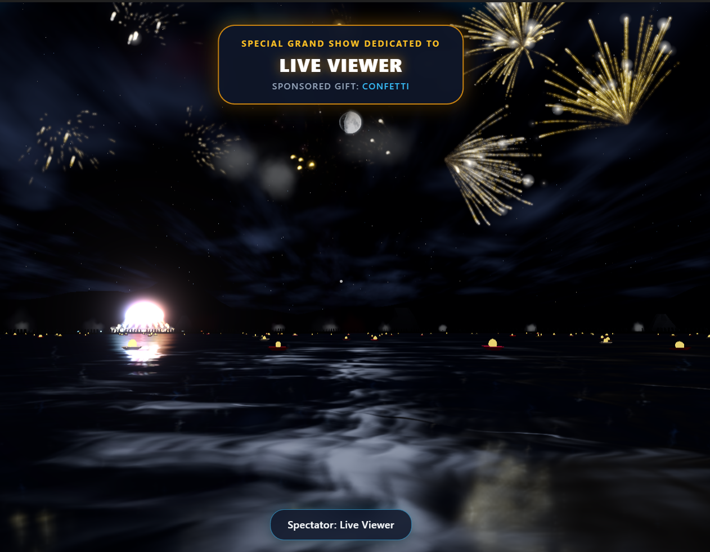
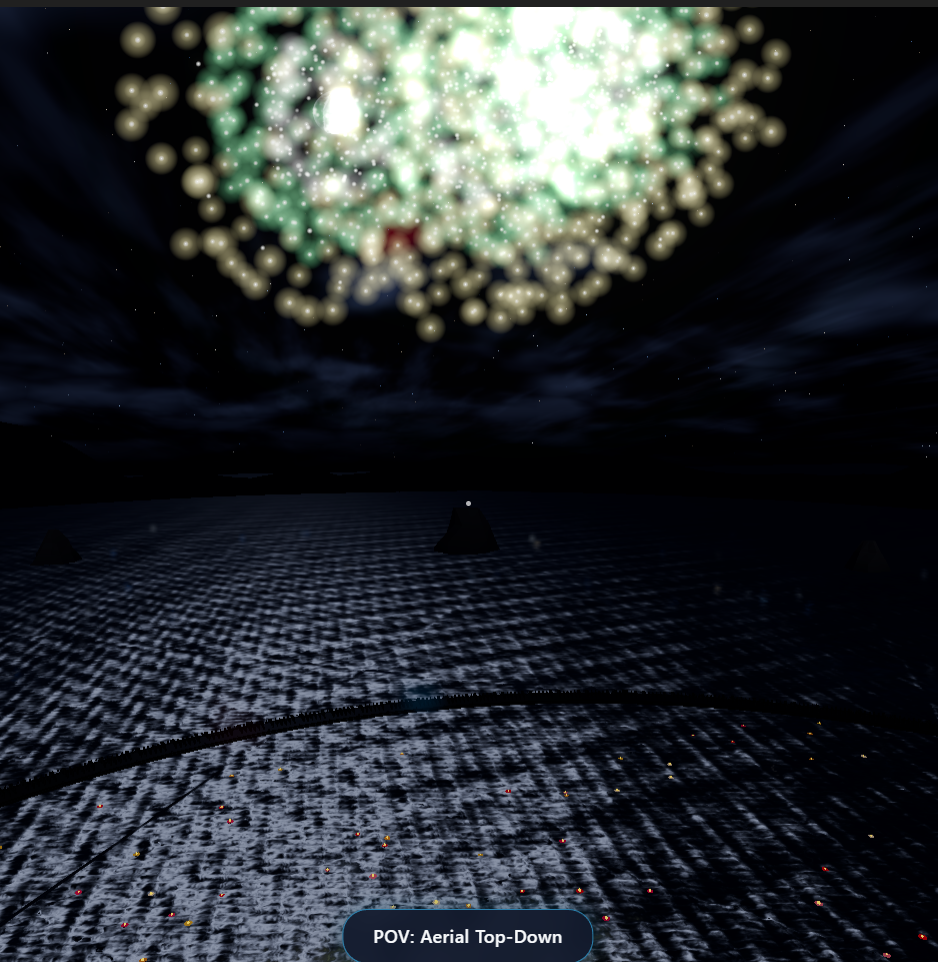
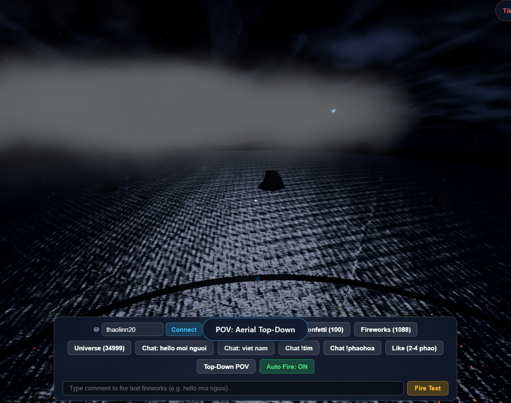

# FDShowLive (Mô phỏng Trình diễn Drone và Pháo hoa 3D)

**Ngôn ngữ:** [English](README_en.md) | [Tiếng Việt](README_vi.md) | [日本語](README_ja.md) | [中文](README_zh.md)

FDShowLive là ứng dụng mô phỏng trình diễn pháo hoa và drone 3D thời gian thực, được thiết kế chuyên biệt để phát sóng trực tiếp và tương tác đa chiều trên Livestream TikTok. Ứng dụng được xây dựng trên nền tảng **Three.js**, **Vite** và **Electron**, kết nối trực tiếp với phòng live thông qua dịch vụ cầu nối WebSocket và TikFinity Webhook.

---

## 1. Tính năng Nổi bật

### Tương tác Livestream TikTok Thời gian thực
- **Thả tim (Likes)**
- **Bình luận (Chat & Word Fireworks)**
- **Tặng quà (Gifts & Priority Sequence Queue)**

### Hệ thống Khán đài và Khán giả 3D (Spectator Crowd)
- Mô phỏng khán đài bờ biển sống động với hàng chục khán giả 3D ngồi và đứng theo dõi buổi trình diễn.
- **Tour khán giả (Spectator Tour)**: Khi sequence đang phát, camera tự động du hành mượt mà giữa các vị trí khán giả (5 giây mỗi vị trí), mang lại trải nghiệm ngồi tại khán đài ngắm pháo hoa.
### Hệ thống Camera Điện ảnh Thông minh
- **Góc nhìn Khán đài Bờ biển (Beachgoer POV)**

- **Góc nhìn Chim bay (Aerial Bird Flyover POV)**


### Bộ công cụ Test Dành cho Streamer & Chế độ Phát sóng Sạch
- **Thanh công cụ Test nhanh (Phím F9)**
- **Chế độ Clean Feed (Phím F10)**


### Động cơ Vật lý Pháo hoa Chuyên nghiệp
- Tích hợp trực tiếp với thư viện động cơ `@shell-drone/firework-engine`.
- Mô phỏng chuyển động có cản cân bằng vận tốc trên GPU (analytical damped velocity), mô phỏng hàng chục ngàn hạt sáng lấp lánh, khói bắn pháo.

---

## 2. Yêu cầu Hệ thống

- **Hệ điều hành**: Windows 10 / 11 (64-bit).
- **Node.js**: Phiên bản 18 trở lên (khuyên dùng bản LTS mới nhất).
- **Git**: Để clone và đồng bộ mã nguồn.
- **Phần mềm Livestream**: TikTok LIVE Studio hoặc OBS Studio.
- **Công cụ Hỗ trợ (Tùy chọn)**: TikFinity (nếu muốn sử dụng cơ chế Webhook).

---

## 3. Cài đặt và Khởi chạy Ứng dụng

### Bước 1: Clone Mã nguồn
Mở Terminal hoặc PowerShell và thực hiện lệnh:
```bash
git clone https://github.com/ThaoLinn20/Shell-Drone-Live.git
cd shell-drone-live
```

### Bước 2: Cài đặt Thư viện Phụ thuộc
Chạy lệnh để cài đặt toàn bộ thư viện cần thiết:
```bash
npm install
```

### Bước 3: Khởi chạy Hệ thống

Tùy thuộc vào mục đích sử dụng, bạn có thể chọn một trong các cách khởi chạy sau:

Lệnh này sẽ đồng thời khởi động cả Cầu nối TikTok (Bridge WebSocket Daemon) và Ứng dụng Desktop Electron:
```bash
npm run live
```
---

## 4. Hướng dẫn Kết nối Với TikTok Livestream

Để ứng dụng tương tác với buổi phát sóng trực tiếp trên TikTok, bạn có thể sử dụng một trong hai phương pháp dưới đây:

### Kết nối qua TikFinity Webhook.
TikFinity là công cụ trung gian giúp tiếp nhận sự kiện từ TikTok Live với độ ổn định cao:
1. Tải và cài đặt phần mềm **TikFinity** từ trang chủ chính thức.
2. Đăng nhập tài khoản TikTok của bạn trên TikFinity và kết nối vào phiên Live đang phát.
3. Trong giao diện TikFinity, truy cập vào mục **Actions & Events** -> **Webhooks** (hoặc cấu hình Trigger Webhook).
4. Thiết lập địa chỉ Webhook URL gửi tới ứng dụng:
   ```text
   http://localhost:21213/api/webhook
   ```
5. Chọn phương thức gửi là `POST`, định dạng dữ liệu là `JSON`.
6. Bật các sự kiện: **Gift**, **Chat / Comment**, **Like / Share**.
7. Ứng dụng sẽ tự động nhận payload từ TikFinity, chuẩn hóa dữ liệu và kích hoạt pháo hoa tương ứng trong không gian 3D.

---

## 5. Hướng dẫn Cấu hình Bắt hình vào TikTok LIVE Studio

1. Mở phần mềm **TikTok LIVE Studio**.
2. Tại khu vực quản lý nguồn phát (Scenes & Sources), nhấn **Add Source** (Thêm nguồn).
3. Chọn kiểu nguồn là **Window Capture** (Bắt cửa sổ) hoặc **Game Capture**.
4. Chọn cửa sổ có tên **FDLiveStream** (hoặc cửa sổ trình duyệt `localhost:5173`).
5. Căn chỉnh tỷ lệ khung hình phù hợp (thường là 16:9 ngang hoặc 9:16 dọc tùy theo phong cách kênh).
6. Trên bàn phím máy tính, bấm vào cửa sổ ứng dụng pháo hoa và nhấn phím **F10**:
   - Màn hình sẽ chuyển sang chế độ **Clean Feed**.
   - Toàn bộ thanh trạng thái, thông số debug, con trỏ và menu sẽ biến mất, chỉ để lại sân khấu trình diễn 3D tuyệt đẹp để lên sóng.

---

## 6. Bảng Phím tắt và Thao tác Điều khiển

### Phím tắt Chuyên dụng cho Streamer
| Phím tắt | Chức năng |
| :--- | :--- |
| **F9** | Bật / Tắt thanh công cụ test nhanh cho Streamer (Test Toolbar) |
| **F10** | Bật / Tắt chế độ phát sóng sạch (Clean Feed - ẩn toàn bộ HUD và menu) |
| **ESC** | Khóa hoặc mở khóa con trỏ chuột khỏi màn hình 3D |
| **SHIFT + Y** | Bật / Tắt bảng thông số kỹ thuật hệ thống (Diagnostics HUD) |

### Điều khiển Camera 3D
| Thao tác | Chức năng |
| :--- | :--- |
| **Chuột trái** | Khóa chuột và xoay hướng nhìn tự do |
| **W, A, S, D** | Di chuyển vị trí camera theo các hướng |
| **SHIFT + W / S** | Nâng cao hoặc hạ thấp độ cao camera |
| **SHIFT + R** | Reset vị trí camera về tâm khán đài ban đầu |
| **1** | Chuyển sang góc nhìn tự do (Free Camera) |
| **2** | Chuyển sang góc nhìn trên thuyền trôi sông (Boat View) |
| **3** | Chuyển sang góc nhìn toàn cảnh trên không (Birds Eye View) |

### Điều khiển Timeline & Chuỗi Trình diễn
| Phím tắt | Chức năng |
| :--- | :--- |
| **CTRL + T** | Bật / Tắt bảng Timeline chỉnh sửa kịch bản |
| **SPACE** | Phát hoặc tạm dừng kịch bản hiện tại |
| **CTRL + S** | Lưu trực tiếp thay đổi vào file JSON kịch bản |
| **CTRL + Z / Y** | Hoàn tác (Undo) hoặc Làm lại (Redo) thao tác |

---

## 7. Đồng bộ và Nâng cấp Động cơ Pháo hoa

Mô phỏng vật lý, hình học, động lực học hạt và các preset pháo hoa được đồng bộ từ kho lưu trữ trung tâm **[@shell-drone/firework-engine](https://github.com/ThaoLinn20/firework-engine)**.

Khi thư viện có bản cập nhật pháo mới, bạn chỉ cần chạy lệnh sau tại thư mục gốc của dự án:
```bash
npm update @shell-drone/firework-engine
```

Kiểm tra và chạy bộ kiểm thử tự động để đảm bảo mọi chức năng hoạt động hoàn hảo:
```bash
npm test
```

---

## 8. Đóng gói Ứng dụng Desktop Windows

Khi bạn muốn đóng gói toàn bộ ứng dụng thành bộ cài đặt Desktop độc lập (`.exe` hoặc file `.zip` chạy ngay) cho hệ điều hành Windows:

Chạy lệnh biên dịch và đóng gói:
```bash
npm run electron:build
```
File cài đặt hoàn chỉnh sẽ được lưu tại thư mục `dist-electron/`.

---

## 9. Nhật ký Thay đổi (Release Notes)

Chi tiết về các tính năng mới, sửa lỗi và lịch sử phát triển được ghi chép đầy đủ tại file [RELEASE_NOTES.md](../../RELEASE_NOTES.md).
