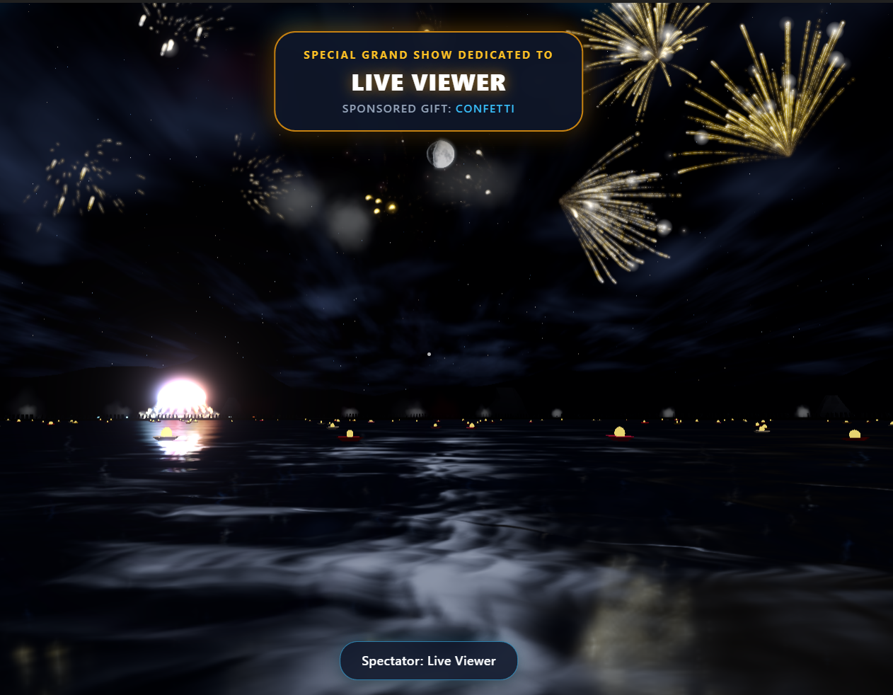
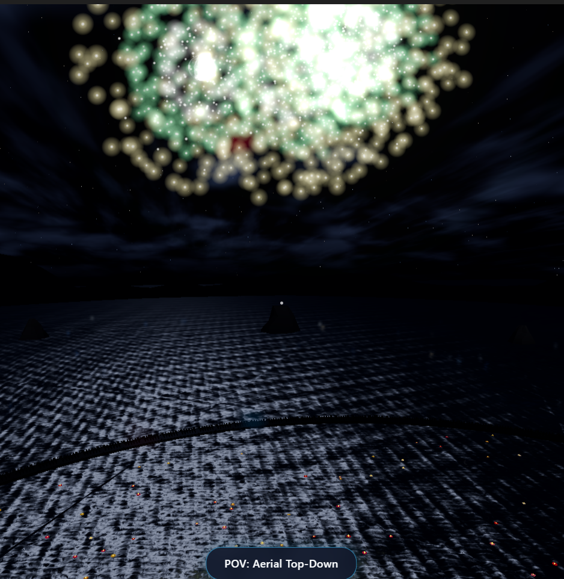
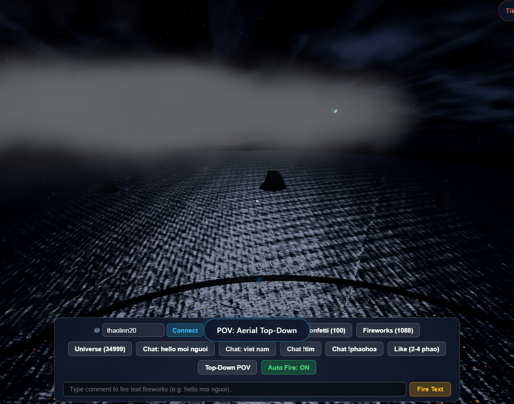

# FDShowLive (3D无人机与烟花现场表演模拟)

**语言:** [English](README_en.md) | [Tiếng Việt](README_vi.md) | [日本語](README_ja.md) | [中文](README_zh.md)

FDShowLive 是一款专为 TikTok Live 直播与多维度实时互动而设计的3D烟花与无人机编队模拟系统。该应用基于 **Three.js**、**Vite** 和 **Electron** 构建，通过本地 WebSocket 桥接守护进程和 TikFinity Webhook 直接连接直播间。

---

## 1. 核心特性

### 实时 TikTok Live 直播互动
- **点赞互动 (Likes)**: 观众的每一次点赞都会在水面上空触发迷你烟花群与低空彗星特效，向点赞观众实时致谢。
- **弹幕聊天与文字烟花 (Chat & Word Fireworks)**:
  - 支持 `!tim`、`!phaohoa` 等预设指令，直接发射专属烟花效果。
  - 程序化文字烟花功能: 自动解析观众弹幕中的词汇，并基于点阵图集（point atlas）坐标系在夜空中按字母发射拼字烟花。
- **送礼与高优先表演队列 (Gifts & Priority Sequence Queue)**:
  - 全面支持 TikTok 各级别礼物，从基础礼物（玫瑰、比心、彩带）到高阶专属大礼（烟花盛典、TikTok Universe）。
  - 高阶礼物将以最高优先级触发包含背景音乐的完整烟花编排与无人机编队灯光秀（Sequence Shows）。
  - 摄像机自动聚焦特写代表送礼赞助观众的3D角色25秒。

### 3D看台与现场观众系统 (Spectator Crowd)
- 海滨观礼台坐落着数十名坐姿与站姿的3D观众角色，营造逼真的线下观演氛围。
- 观众背部配有运动球衣风背号牌（Jersey Plate Banner），醒目展示 FWA 品牌、高清放大观众昵称以及专属荣誉勋带。
- **看台巡礼漫游 (Spectator Tour)**: 在音乐编排序列播放期间，摄像机在各个观众视角之间平滑巡航（每个机位停留5秒），带来身临其境的看台观演体验。
- 视野视线优化: 摄像机聚焦的观众角色会自动隐藏，周围邻近观众自动半透明化（透明度降至0.78），确保朝向湖面舞台的视野100%通透无遮挡。

### 智能电影级运镜系统
- **沙滩观众视角 (Beachgoer POV)**: 默认机位坐落于沙滩斜坡，隔水远眺平静湖面上映出的烟花倒影与夜空华彩。

- **高空鸟瞰视角 (Aerial Bird Flyover POV)**:

  - 摄像机翱翔于高空（Y = 235m 至 255m，Z = 380m 至 405m），视线目标点锁定在145m高空，完整容纳从低空75m至最高400m绽放的各类大型烟花。
  - 智能概率控制: 单发/环境发射时触发概率为30%；在音乐表演序列（sequence）播放期间，整场节目最多仅有5%的触发概率，把全部演出时间完整留给看台观众视角。
  - 鸟瞰巡航结束后，摄像机会极其平滑地降落回当前观礼观众身后，无缝衔接看台巡礼而不会意外中断。

### 主播快速调试面板与纯净输出模式
- **主播测试工具栏 (快捷键 F9)**: 屏幕底部可调出的集成控制台，支持快速填入 TikTok 账号连接直播间、模拟点赞、聊天、送礼以及快速测试各类运镜机位。
- **纯净直播输出模式 (快捷键 F10)**: 一键隐藏屏幕上所有状态文本、调试指标、十字准星与控制菜单，提供无杂质的纯净3D画面以便推流捕获。


### 专业烟花物理渲染引擎
- 核心物理运算直接依托独立中心库 `@shell-drone/firework-engine`。
- 在 GPU 顶点着色器上完整运行闭式解析阻尼速度模型（analytical damped velocity），实现零 CPU 循环开销，完美还原数万颗滞空闪烁火星、发射筒烟雾、水面平面反射与夜空爆闪光照。

---

## 2. 系统环境要求

- **操作系统**: Windows 10 / 11 (64-bit)。
- **Node.js**: 18 及以上版本（推荐使用最新的 LTS 长期支持版）。
- **Git**: 用于克隆与同步代码仓库。
- **直播推流软件**: TikTok LIVE Studio 或 OBS Studio。
- **辅助工具 (可选)**: TikFinity（如需使用 Webhook 方案）。

---

## 3. 安装与运行指南

### 步骤 1: 克隆代码仓库
打开终端或 PowerShell 执行：
```bash
git clone https://github.com/ThaoLinn20/Shell-Drone-Live.git
cd shell-drone-live
```

### 步骤 2: 安装依赖项
执行命令安装所有必需的依赖库：
```bash
npm install
```

### 步骤 3: 启动应用程序

根据您的具体使用场景，选择以下运行方式之一：

#### 方案 1: 全功能直播模式 (主播推荐)
该命令将同时启动 TikTok WebSocket 桥接守护进程和 Electron 桌面端应用程序：
```bash
npm run live
```
*(亦可使用等效命令: `npm run live:desktop`)*

#### 方案 2: 在标准 Web 浏览器中运行
如需在浏览器（Chrome / Edge）中与桥接服务配合运行：
```bash
npm run live:web
```
在浏览器中访问地址: `http://localhost:5173/`

#### 方案 3: 独立启动各组件
如需进行局部调试或单独运行服务：
- 启动桥接服务并连接指定 TikTok 账号：
  ```bash
  node bridge/server.js [tiktok_用户名]
  ```
  *(示例: `node bridge/server.js thaolinn20`)*
- 启动 Electron 桌面应用窗口：
  ```bash
  npm run electron:dev
  ```

---

## 4. 连接 TikTok 实时直播间

您可以通过以下两种方式将直播间事件无缝接入3D空间：

### 方案 1: 通过 TikTok Live Connector 直接连接 (最简单快捷)
1. 在手机或 TikTok LIVE Studio 上开启您的 TikTok 直播。
2. 运行 `npm run live` 启动应用。
3. 在应用窗口中按下 **F9** 键调出测试工具栏。
4. 在 **TikTok @username** 输入框中输入您的主播账号用户名，然后点击 **Connect** 按钮。
5. WebSocket 桥接将自动挂载进直播间，实时接收点赞、聊天弹幕与礼物事件。

### 方案 2: 通过 TikFinity Webhook 接入 (稳定性极佳)
TikFinity 可作为高效稳定的中间层转发服务：
1. 从官方渠道下载并安装 **TikFinity** 软件。
2. 在 TikFinity 中登录您的 TikTok 账号并连接至当前正在开播的直播间。
3. 进入 TikFinity 的 **Actions & Events** -> **Webhooks**（或 Webhook 触发器设置）。
4. 将 Webhook URL 目标地址配置为：
   ```text
   http://localhost:21213/api/webhook
   ```
5. 请求方法选择 `POST`，数据格式选择 `JSON`。
6. 勾选需要转发的事件：**Gift**、**Chat / Comment**、**Like / Share**。
7. 应用将自动解析 TikFinity 发送的载荷数据，规范化后在3D场景中燃放对应烟花。

---

## 5. 画面捕获推流至 TikTok LIVE Studio / OBS Studio

1. 打开 **TikTok LIVE Studio**（或 OBS Studio）。
2. 在场景与来源管理面板中，点击 **添加来源 (Add Source)**。
3. 选择 **窗口捕获 (Window Capture)** 或 **游戏捕获 (Game Capture)**。
4. 来源窗口选择名为 **FDLiveStream**（或浏览器窗口 `localhost:5173`）。
5. 调整画面长宽比（通常根据频道风格选择横屏 16:9 或竖屏 9:16）。
6. 单击激活3D烟花窗口，在键盘上按下 **F10** 键：
   - 画面随即切换为 **Clean Feed (纯净输出)** 模式。
   - 所有界面文本、调试面板、鼠标光标与菜单瞬时隐藏，只呈现华丽震撼的3D表演画面以供推流。

---

## 6. 快捷键与控制指南

### 主播推流专属快捷键
| 快捷键 | 功能描述 |
| :--- | :--- |
| **F9** | 开启 / 关闭主播快速测试工具栏 (Test Toolbar) |
| **F10** | 开启 / 关闭纯净输出模式 (Clean Feed - 隐藏全部 HUD 与菜单) |
| **ESC** | 锁定或释放鼠标光标控制权 |
| **SHIFT + Y** | 开启 / 关闭系统性能与诊断监视面板 |

### 3D 摄像机漫游控制
| 操作 | 功能描述 |
| :--- | :--- |
| **鼠标左键** | 锁定光标并自由旋转观察视角 |
| **W, A, S, D** | 平面水平移动摄像机位置 |
| **SHIFT + W / S** | 抬高或降低摄像机飞行高度 |
| **SHIFT + R** | 重置摄像机位置至看台中心基准点 |
| **1** | 切换为自由漫游摄像机 (Free Camera) |
| **2** | 切换为江面游船漫游视角 (Boat View) |
| **3** | 切换为高空全景俯瞰视角 (Birds Eye View) |

### 时间轴与节目编排控制
| 快捷键 | 功能描述 |
| :--- | :--- |
| **CTRL + T** | 开启 / 关闭时间轴编排面板 |
| **SPACE** | 播放或暂停当前节目序列 |
| **CTRL + S** | 直接将修改保存写入节目 JSON 文件 |
| **CTRL + Z / Y** | 撤销 (Undo) 或 重做 (Redo) 编辑操作 |

---

## 7. 烟花物理引擎同步与升级

所有烟花数学模型、空间几何构型、粒子运动学及特效预设均统一在中心代码库 **[@shell-drone/firework-engine](https://github.com/ThaoLinn20/firework-engine)** 中维护。

当底层引擎发布新烟花预设或性能补丁时，在本项目根目录执行更新命令即可：
```bash
npm update @shell-drone/firework-engine
```

执行自动化单元测试以确认系统功能运行正常：
```bash
npm test
```

---

## 8. 打包 Windows 桌面独立安装程序

若需将整个项目编译打包为独立的 Windows 桌面客户端（`.exe` 安装包或解压即用的 `.zip` 便携包）：

运行自动化构建与打包命令：
```bash
npm run electron:build
```
生成的安装包将存放在 `dist-electron/` 文件夹中。

---

## 9. 版本更新说明 (Release Notes)

详尽的新功能清单、问题修复及版本演进记录请参阅 [RELEASE_NOTES.md](../../RELEASE_NOTES.md)。
